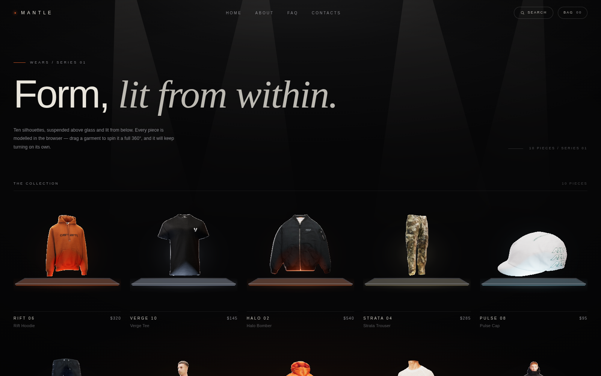
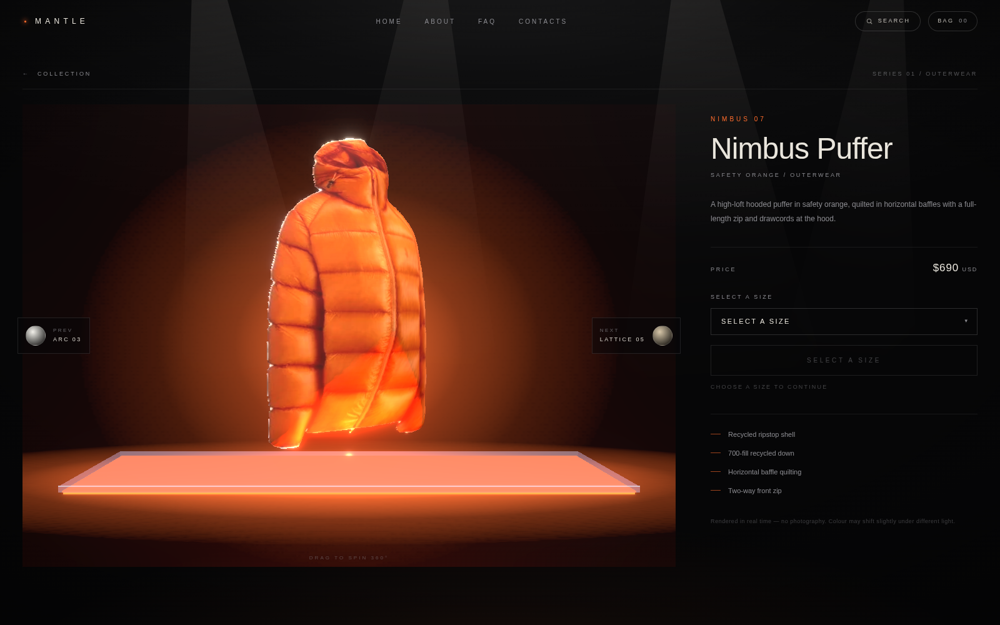

# MANTLE — Form, lit from within.

A dark, spotlit 3D storefront for a "wears" collection: ten garments floating on glowing
glass shelves in a 5×2 gallery. Click a silhouette and it lifts into a detail view with a
large, draggable, auto-rotating 3D product above an ember-lit shelf, a size selector and a
working bag.

Every piece is the **real product photo**, turned into 3D. Each shot is background-removed
into a transparent cut-out and paired with a grayscale depth map; a dense plane is pushed
along that map and its normals recomputed, so a flat photo becomes a puffed, shaded slab
with real parallax. Because it is genuine geometry, drag spins the piece a full **360°**:
front, silhouette edge, and the mirrored back. Nothing is a fake CSS tilt.





## Stack

| Layer     | Choice                                                              |
| --------- | ------------------------------------------------------------------- |
| Frontend  | Vite · React 18 · TypeScript · Tailwind CSS · framer-motion          |
| 3D        | three.js · @react-three/fiber · @react-three/drei · postprocessing   |
| Backend   | Vercel serverless functions (Node, TypeScript) in `/api`             |

## Layout

```
assets/source/           Original product photos (10)
public/wears/            Generated cut-outs + depth maps (built by the script below)
api/                     Vercel functions (the backend)
  products/index.ts        GET  /api/products
  products/[slug].ts       GET  /api/products/:slug
  orders/index.ts          GET  /api/orders   (count only)
                           POST /api/orders   (create an order)
server/                  Shared backend code
  types.ts                 Product / Order types shared with the frontend
  products.ts              The catalogue: 10 garments, prices, sizes, colours
  orders.ts                Validation, server-side pricing, order store
src/                     Frontend
  three/                   Wear.tsx (photo -> inflated 3D mesh) · Shelf.tsx
                           Studio.tsx · GalleryCanvas.tsx · ProductStage.tsx
  components/              Header · Footer · ProductTile · BagDrawer · Atmosphere
  pages/                   Home (gallery) · ProductPage (detail)
  store/BagContext.tsx     Bag state + order submission
  lib/                     api client · types · hooks
scripts/                 process_wears.py (cut-outs + depth maps) · smoke.mjs · check-wears.mjs
```

### Building the wear assets

```bash
pip install rembg onnxruntime scipy pillow numpy
npm run assets
```

For every photo in `assets/source/` this writes `public/wears/<slug>.webp` (cut-out) and
`public/wears/<slug>-depth.webp` (height map). The depth map is a smoothed euclidean
distance transform of the alpha mask, so the centre of a piece bulges forward and the edges
taper to the silhouette. To add a product: drop `<slug>.webp` into `assets/source/`, run
`npm run assets`, then add the entry to `server/products.ts`.

### How the 3D gallery works

One WebGL context for the whole page. `GalleryCanvas` mounts a fixed, click-through
`<Canvas>` and each `ProductTile` renders a drei `<View>`, which scissors its own scene
into that shared canvas. Ten shelves therefore cost one renderer instead of ten, and the
tiles stay ordinary DOM elements (links, hover states, accessibility) on top.

The detail page mounts its own `ProductStage` canvas with a drag-rotate group (with
inertia and a slow idle auto-rotation) plus a bloom pass for the shelf glow.

## Run it locally

```bash
npm install
npm run dev          # http://localhost:5173
```

`vite.config.ts` includes a small dev middleware that serves the `/api` handlers through
Vite, so local behaviour matches production. No second server to start.

```bash
npm run build        # tsc --noEmit && vite build
npm run preview      # static preview of dist/ (no API routes)
npm run typecheck
npm run smoke        # Playwright smoke test against a running server
```

`npm run smoke` expects `SMOKE_BASE` (default `http://127.0.0.1:4173`) and Chrome at
`/usr/bin/google-chrome`. It checks the catalogue API, that ten tiles mount, that each
tile's canvas contains rendered pixels, that clicking opens the detail view, that the size
select works, and that `POST /api/orders` returns 201.

## API

`GET /api/products`

```json
{ "products": [ { "slug": "rift-06", "code": "RIFT 06", "name": "Rift Hoodie",
                  "price": 148, "model": "hoodie", "color": "#B4552F",
                  "accent": "#FF6B2C", "sizes": ["S", "M", "L", "XL", "XXL"] } ],
  "count": 10 }
```

`GET /api/products/:slug` → `{ "product": {...}, "neighbours": { "prev": {...}, "next": {...} } }`

`POST /api/orders`

```json
{ "items": [ { "slug": "rift-06", "size": "L", "quantity": 1 } ], "note": "optional" }
```

Prices are recomputed server-side from the catalogue, never trusted from the client.
Returns `201` with the created order, `400` on validation failure, `405` on a wrong method.

### Orders storage

`server/orders.ts` keeps orders in memory, mirrored to a JSON file under `/tmp` so they
survive a warm lambda. That is deliberate for a demo: **serverless instances are
ephemeral, so orders are not durable.** To make them real, swap the two functions at the
top of `server/orders.ts` (`readStore` / `writeStore`) for a database call — the rest of
the module does not change. The project already works with Neon Postgres or Supabase via a
single `DATABASE_URL`.

## Deploy

```bash
vercel --prod
```

`vercel.json` pins the framework to Vite, builds to `dist/`, and runs `api/**/*.ts` as
Node functions. Nothing else is required: the frontend calls same-origin `/api/*`.

## Notes and limitations

- The 360° is depth-inflated from a single photograph per piece, not a photogrammetry or
  multi-angle capture. It reads as a real 3D object turning, but a true multi-angle spin
  needs either a turntable photo sequence or a modelled GLB. For the latter, swap `<Wear />`
  in `src/three/Wear.tsx` for drei's `useGLTF` — shelf, lighting and stage stay as they are.
- The gallery keeps one canvas for ten views. On low-end mobile GPUs, lower `dpr` in
  `GalleryCanvas.tsx`.
- No checkout or payment provider is wired up; "Add to bag" places an order through
  `POST /api/orders`.
